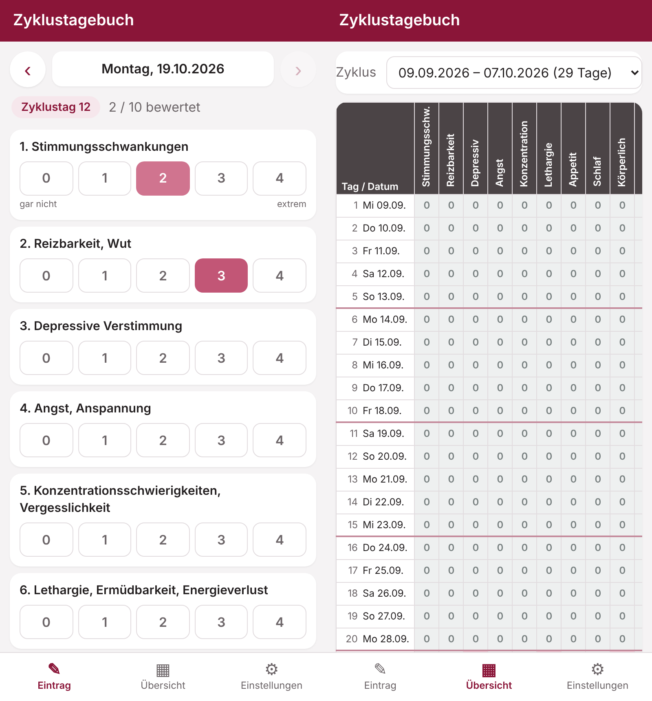
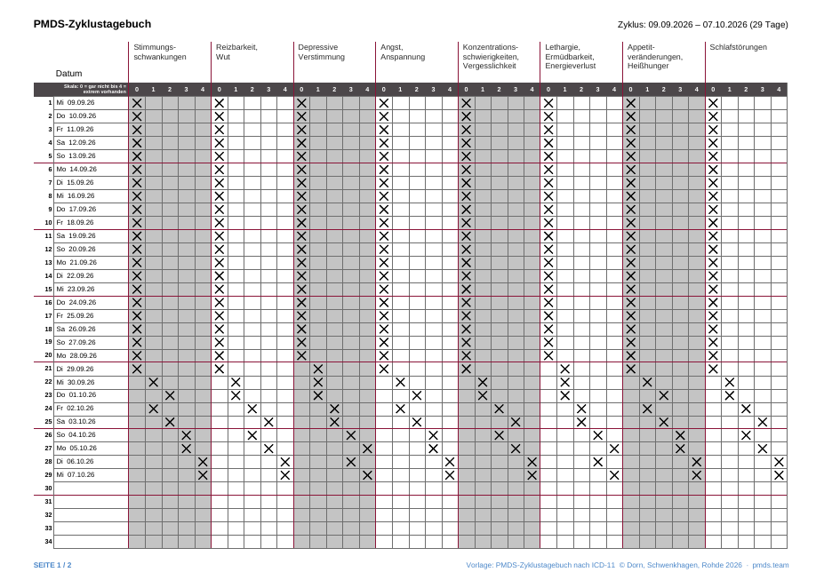

# Zyklustagebuch – PMDS-Zyklustagebuch als Android-App

Eine persönliche Android-App zum täglichen Führen des **PMDS-Zyklustagebuchs (nach ICD-11)**:
Symptome von 0 bis 4 bewerten, Notizen eintragen, den Zyklus als Tabelle ansehen und als PDF im
Layout der Papiervorlage exportieren – mit täglicher Erinnerung zur selbst gewählten Uhrzeit.

> **Originalquelle:** Die App setzt das *PMDS-Zyklustagebuch zum Ratgeber (nach ICD-11 Kriterien)*
> von **Dorn, Schwenkhagen und Rohde** (© 2026) digital um. Die Original-Vorlage und der Ratgeber sind
> unter **<https://pmds.team/>** erhältlich. Inoffizielle Umsetzung, ohne Verbindung zu den Autorinnen –
> Details unter [Quelle](#quelle).



## Funktionen

- **Täglicher Eintrag**: 10 Symptome auf der Skala 0 (gar nicht) bis 4 (extrem vorhanden)
  - Stimmungsschwankungen · Reizbarkeit, Wut · Depressive Verstimmung · Angst, Anspannung ·
    Konzentrationsschwierigkeiten, Vergesslichkeit · Lethargie, Ermüdbarkeit, Energieverlust ·
    Appetitveränderungen, Heißhunger · Schlafstörungen · Körperliche Symptome · Andere Symptome
  - Freitext: *Auswirkungen auf Studium / Beruf / Familienleben* und *Besondere Belastungen / Ereignisse*
  - Zyklustag wird automatisch berechnet; neuer Zyklus per Knopfdruck am 1. Tag der Periode
- **Übersicht**: Zyklus als farbige Tabelle (Tage × Symptome), Tippen öffnet den Tag
- **PDF-Export** (teilen oder speichern): zwei A4-Querformatseiten wie Seite 2 und 3 der Vorlage,
  Kreuze in den gewählten Kästchen, zu lange Notizen vollständig auf einer Zusatzseite
  ([Beispiel](docs/beispiel-export.pdf))
- **Tägliche Erinnerung** zur eigenen Uhrzeit (entfällt, wenn der Tag schon vollständig ausgefüllt ist;
  bleibt nach Neustart aktiv)
- **Datensicherung** als JSON-Datei exportieren / importieren. Alle Daten bleiben lokal auf dem Gerät.



## Installation

APK bauen (siehe unten) oder aus den Releases laden, auf das Android-Gerät kopieren und öffnen
(„Installation aus unbekannten Quellen“ erlauben). Mindestens Android 8.0.

Tipp: Falls Erinnerungen nicht erscheinen, in den Android-Einstellungen den Akkuverbrauch der App
auf „Nicht eingeschränkt“ stellen.

## Bauen

Kein Gradle / Android Studio nötig. Unter Debian/Ubuntu:

```sh
sudo apt install openjdk-21-jdk-headless aapt apksigner zipalign dalvik-exchange zip
./build.sh            # -> build/Zyklustagebuch.apk
```

`build.sh` lädt bei Bedarf die `android.jar` (API 34) und erzeugt beim ersten Lauf einen
Signaturschlüssel unter `tools/release.jks` (Passwort per `KS_PASS`, Pfad per `KEYSTORE` änderbar).
**Den Schlüssel sicher aufbewahren und nicht einchecken** – Updates lassen sich nur mit demselben
Schlüssel über eine installierte Version installieren.

### Aufbau

| Pfad | Inhalt |
|---|---|
| `app/assets/` | Oberfläche (`index.html`, `app.js`, `style.css`) und PDF-Layout (`pdf.js`, mit jsPDF) |
| `app/src/` | Android-Hülle: WebView, Speicherung (`data.json`), Wecker/Benachrichtigungen, Dateien speichern/teilen |
| `app/AndroidManifest.xml`, `app/res/` | Manifest, Icons |

Die Oberfläche läuft auch im normalen Browser (`app/assets/index.html` öffnen); die Daten liegen dann im localStorage.

## Quelle

Inhalt und Layout des Tagebuchs basieren auf dem **PMDS-Zyklustagebuch zum Ratgeber
(NEU: nach ICD-11 Kriterien)**, © Dorn, Schwenkhagen, Rohde 2026 – veröffentlicht vorab zur
3. Auflage ihres PMDS-Ratgebers (Erscheinen Herbst 2026).
Die Original-Vorlage (PDF) gibt es unter **<https://pmds.team/>**.
Symptomliste, Skala, Ausfüllhinweise und Seitenaufbau stammen aus dieser Vorlage; die App ist eine
unabhängige, inoffizielle Umsetzung und steht in keiner Verbindung zu den Autorinnen.
Die Rechte an der Vorlage verbleiben bei den Autorinnen, die Vorlage selbst ist nicht Teil dieses Repositorys –
bitte direkt von <https://pmds.team/> beziehen.
Der PDF-Export nennt die Vorlage in der Fußzeile.

Die App ersetzt keine ärztliche Beratung. Das ausgefüllte Tagebuch dient als Grundlage für das Gespräch
mit Ärztin oder Arzt.

## Lizenz

Der Quellcode dieser App steht unter der
**[PolyForm Noncommercial License 1.0.0](LICENSE.md)**: Nutzung, Änderung und Weitergabe sind für
**nicht-kommerzielle Zwecke** erlaubt (z. B. private Nutzung, Forschung, gemeinnützige Organisationen);
**kommerzielle Nutzung ist nicht gestattet**.

Required Notice: Copyright (c) 2026 Jessica Kaechele

Mitgelieferte Software Dritter:
- [jsPDF](https://github.com/parallax/jsPDF) (`app/assets/jspdf.umd.min.js`) – MIT-Lizenz, © 2010–2021 James Hall, yWorks GmbH
